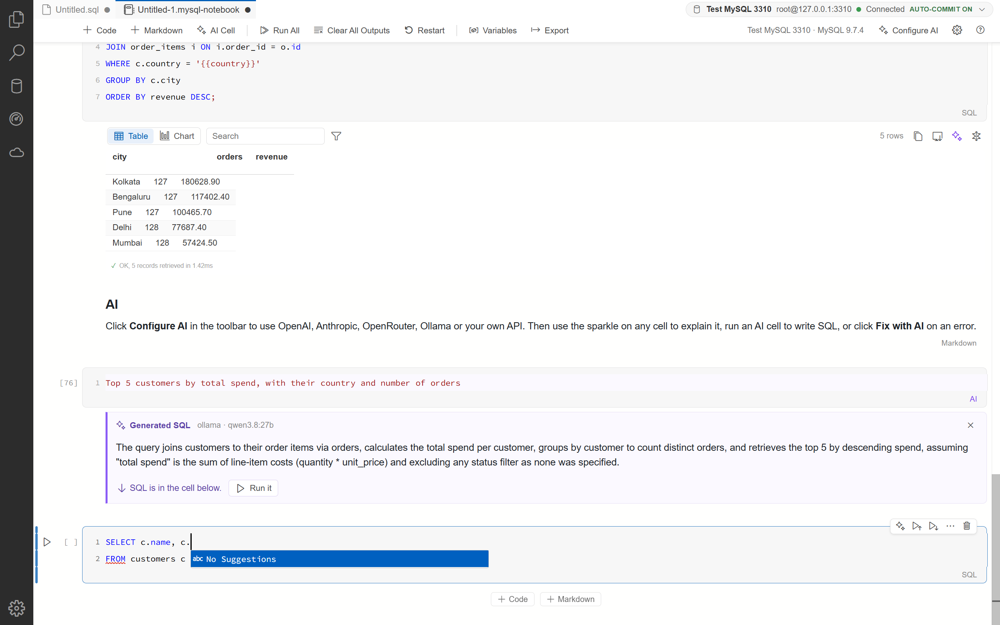

<div align="center">

# KGP Talkie MySQL Workbench plugin

**A Jupyter-style notebook for MySQL Workbench 26, with AI, result charts, exports and a VS Code-style workspace.**

It runs on top of your installed Workbench and does not change a single Workbench file.

[](LICENSE)


[Install](#install) · [Features](#features) · [How it works](#how-it-works) · [Development](#development) ·
[Changelog](CHANGELOG.md)


</div>

## Contents

- [Features](#features)
- [Requirements](#requirements)
- [Install](#install)
- [Update and uninstall](#update-and-uninstall)
- [How it works](#how-it-works)
- [Privacy and security](#privacy-and-security)
- [Troubleshooting](#troubleshooting)
- [Repository layout](#repository-layout)
- [Development](#development)
- [Contributing](#contributing)
- [License](#license)

## Features

### Notebook

- One box per cell, line numbers, `[n]` run counts, a play button on hover, Markdown cells that render when you
  leave them.
- Notebook bar: + Code, + Markdown, + AI Cell, Run All (waits for every statement), Clear All Outputs, Restart,
  Variables, Export.
- Command mode like Jupyter: Esc, then A/B add, D D delete, M/Y change type, C/X/V copy/cut/paste, Z undo. Every cell
  action is one undo step, and a deleted cell comes back with its output.
- The bar shows which server the notebook talks to, for example `Local · MySQL 9.4.0`, plus a Production or
  Read-only tag.

### Typing SQL

- MySQL keywords turn into capitals as you type. Names, strings, comments, `quoted` names and `{{variables}}` stay as
  typed, and one Ctrl+Z puts a word back. The keyword lists come from the
  [sql-formatter](https://github.com/sql-formatter-org/sql-formatter) MySQL dialect, not a hand-kept list.
- Autocomplete matches in any case and fuzzily (`slt` finds SELECT, `cstm` finds customers), lists the columns after
  an alias or table name (`c.`), and inserts keywords in UPPERCASE, lowercase or as typed.
- Shift+Alt+F turns a query into one clause per line and back.



### Results

- Search, per-column filters (`>500`, `1..5`, `null`, `!text`), sort, copy as CSV, TSV, JSON, Markdown or INSERT,
  save as CSV or JSON, a value viewer on double-click.
- Charts: bar, line, area, scatter and pie, stacked or horizontal, saved per cell.


### Running safely

- `{{name}}` variables (asked once per session or saved with the notebook) and `{{env.NAME}}`.
- Asks before DROP, TRUNCATE, or DELETE / UPDATE without WHERE. Connections can be tagged Production or Read-only.
- Query timeout.


### AI

- OpenAI, Anthropic, OpenRouter, Ollama, or any OpenAI-compatible API (LM Studio, vLLM, LiteLLM).
- Explain a cell, optimize it (with its EXPLAIN plan), Fix with AI on errors, explain a result, and AI cells that
  turn plain words into SQL in the cell below.
- Your API key stays on your PC, encrypted (see [Privacy and security](#privacy-and-security)).


### Files and schema

- Export the notebook as HTML (charts included), PDF, Markdown, `.sqlnb` or `.sql`. Import `.sql` or `.sqlnb`.
- Schema tree: Select Top 100 in Notebook and Describe in Notebook.
- A VS Code-style activity bar with an Explorer panel for a folder of `.sql` and notebook files, and a sample
  notebook (`sample_shop`) under Get Started.

## Requirements

| | |
|---|---|
| Operating system | Windows 10 or 11 (64-bit) |
| MySQL Workbench | 26 (the new Workbench that replaces Workbench 8 and MySQL Shell for VS Code). Tested with 26.10.0. |
| Rights | A normal user account. No admin rights are needed. |
| Optional | Microsoft Edge for PDF export (it ships with Windows). An AI provider account or a local Ollama for AI. |

## Install

1. Download `Workbench-KGP-Setup.exe` from the
   [Releases page](https://github.com/laxmimerit/mysql-workbench-plugin/releases) (or build it, see
   [Development](#development)).
2. Run it. It installs for your user only, in `%LOCALAPPDATA%\Programs\Workbench KGP`, and adds a
   **Workbench (KGP)** shortcut to the Desktop and the Start menu.
3. Open **Workbench (KGP)**.

Plain MySQL Workbench stays exactly as it was and still opens from its own shortcut. Workbench allows one window per
profile, so close plain Workbench before you open Workbench (KGP).

## Update and uninstall

- **Update:** run the new `Workbench-KGP-Setup.exe`. It replaces the installed copy and keeps your settings and AI
  configuration.
- **Uninstall:** Settings > Apps > Installed apps > Workbench (KGP) > Uninstall. This removes the program folder, the
  shortcuts and the Apps entry. MySQL Workbench is not touched. Your AI settings stay in
  `%APPDATA%\Workbench KGP`; delete that folder too if you want them gone.

## How it works

MySQL Workbench 26 is an Electron app whose launcher accepts a `--renderer-url` option. The Workbench (KGP) shortcut
starts a small local server on `127.0.0.1:9241` and opens Workbench with that option. The server hands Workbench its
own installed frontend, read-only, with one extra `<script>`: `plugin/kgp-plugin.js`. Nothing in the Workbench
install folder is modified, and the server stops by itself a few minutes after the last Workbench window closes.

`docs/internals/NOTEBOOK-PLAN.md` explains the Workbench internals the plugin relies on, and
`docs/SQLNB-FEATURES.md` maps every feature to the SQL Notebook Studio feature it ports.

## Privacy and security

- The plugin server listens on `127.0.0.1` only. Its file, AI and PDF endpoints answer Workbench's own page only
  (origin and host checks plus a custom header, so other web pages are refused).
- The Explorer reads files only; it never writes or deletes.
- AI API keys are stored with Windows DPAPI in `%APPDATA%\Workbench KGP\ai.json`, readable only by your Windows
  account. They are never sent to the page and never written into notebooks.
- AI requests go from the local server straight to the provider you choose. Result rows are sent only after you
  agree (or when you pick a local model or "Always allow").
- No telemetry.

Found a security problem? See [SECURITY.md](SECURITY.md).

## Troubleshooting

| Problem | What to do |
|---|---|
| "Port 9241 is in use by another program" | Another program holds the port. Close it, or open plain Workbench from its own shortcut. |
| "MySQL Workbench is already open without the plugin" | Close Workbench (File > Exit), then open Workbench (KGP) again. |
| "MySQL Workbench 26 was not found" | Install MySQL Workbench 26 first. The plugin looks in `%LOCALAPPDATA%\Programs` and `Program Files`. |
| PDF export fails | PDF export uses Microsoft Edge. Check that Edge is installed. |
| Something else went wrong | The launcher writes details to `%TEMP%\workbench-kgp.log`. Please attach it to a [bug report](https://github.com/laxmimerit/mysql-workbench-plugin/issues/new/choose). |

## Repository layout

| Path | What it is |
|---|---|
| `plugin/kgp-plugin.js` | The plugin: everything that runs inside Workbench |
| `package/kgp_workbench.py` | One program that is the installer, the launcher and the local server |
| `package/build.ps1` | Builds `package/dist/Workbench-KGP-Setup.exe` with PyInstaller |
| `launch.py` | Starts the server from this folder and opens Workbench with the plugin (development) |
| `tools/` | `gen-keywords.mjs` (MySQL keyword lists from sql-formatter), `cdp.py` and `snap.js` (drive a Workbench started with a debug port) |
| `test-mysql/my.ini` | Settings for the throwaway MySQL server used in tests |
| `docs/` | Feature map, notes on Workbench internals, screenshots |
| `.github/` | Issue and pull request templates, CI checks |

## Development

Requirements: Node.js 22 or later, Python 3.12 or later with `requests` and `websocket-client` (test tools), and
PyInstaller (installer build).

```bash
npm install
npm run keywords
py launch.py
```

`npm run keywords` rewrites the block between `KEYWORDS:BEGIN` and `KEYWORDS:END` in `plugin/kgp-plugin.js`. Run it
after updating sql-formatter. `npm run check` checks the syntax of the plugin and the Python programs.

Build the installer:

```bash
powershell -File package/build.ps1
```

Risky changes are tested in a separate, hidden Workbench with its own profile and a throwaway MySQL server, never in
your everyday Workbench.

## Contributing

Bug reports and ideas are welcome. Please read [CONTRIBUTING.md](CONTRIBUTING.md) and the
[Code of Conduct](CODE_OF_CONDUCT.md) first.

## License

Apache License 2.0. See [LICENSE](LICENSE) and [NOTICE](NOTICE). If you redistribute this plugin or a work based on
it, keep the NOTICE file with it. Third-party licenses are in [THIRD-PARTY-NOTICES.txt](THIRD-PARTY-NOTICES.txt).

### Trademarks

The license covers the code, not the names. "KGP Talkie" and its logo are not licensed for use by forks; if you
publish a fork, give it your own name. MySQL and MySQL Workbench are trademarks of Oracle and/or its affiliates. This
plugin is not made, endorsed or supported by Oracle.
