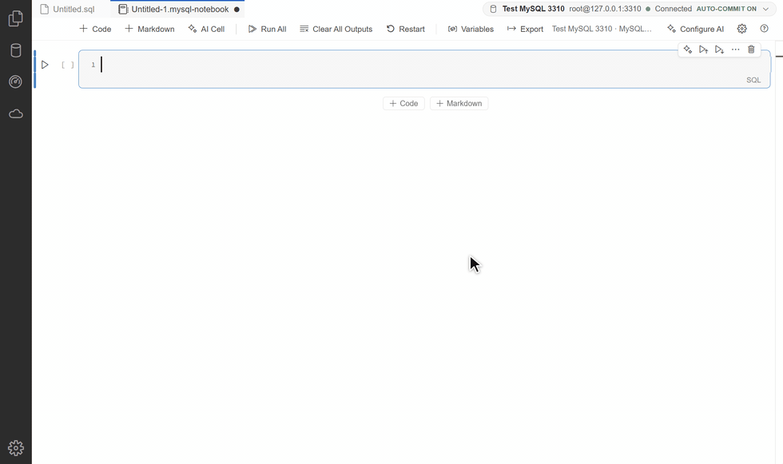
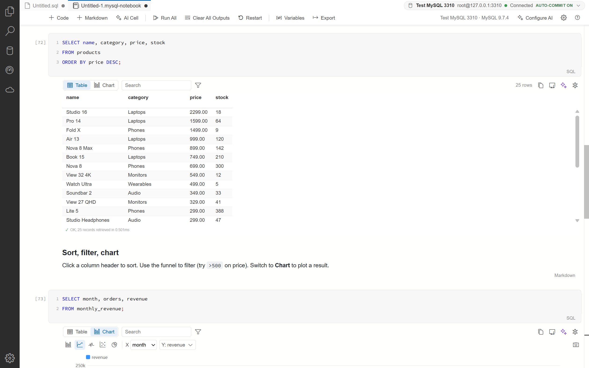
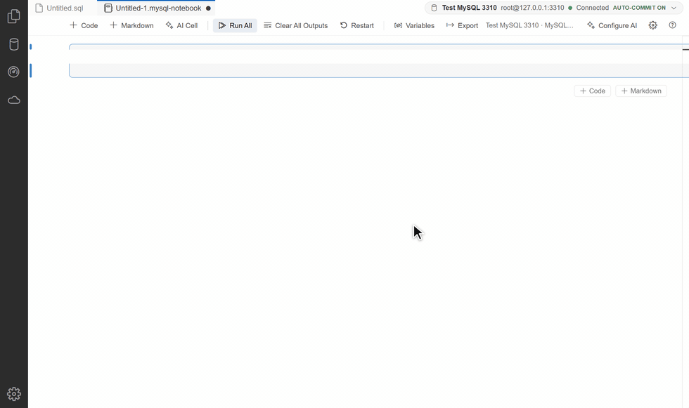
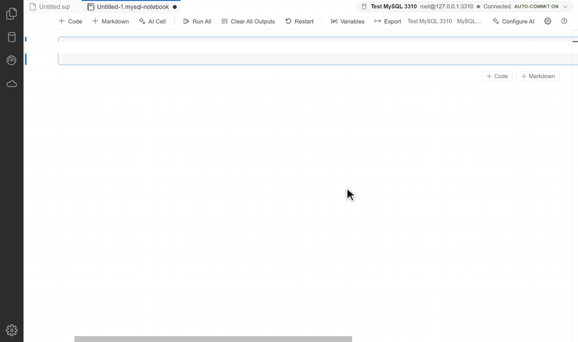
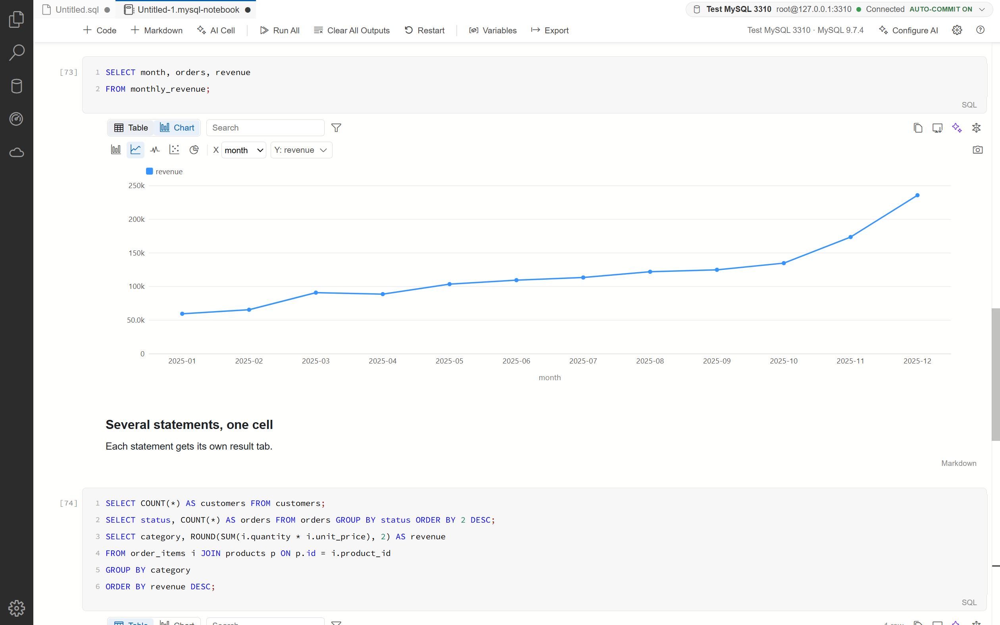
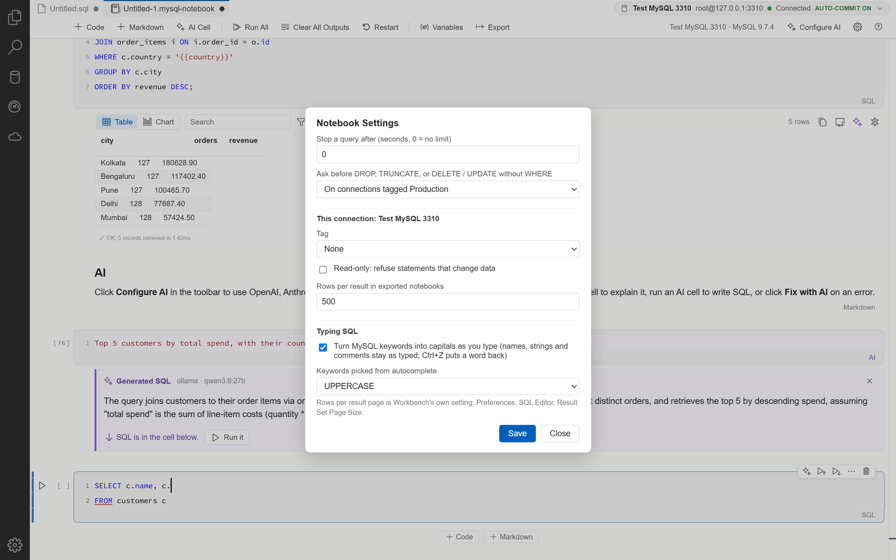
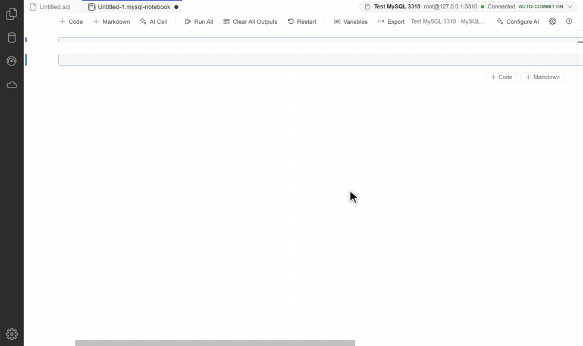
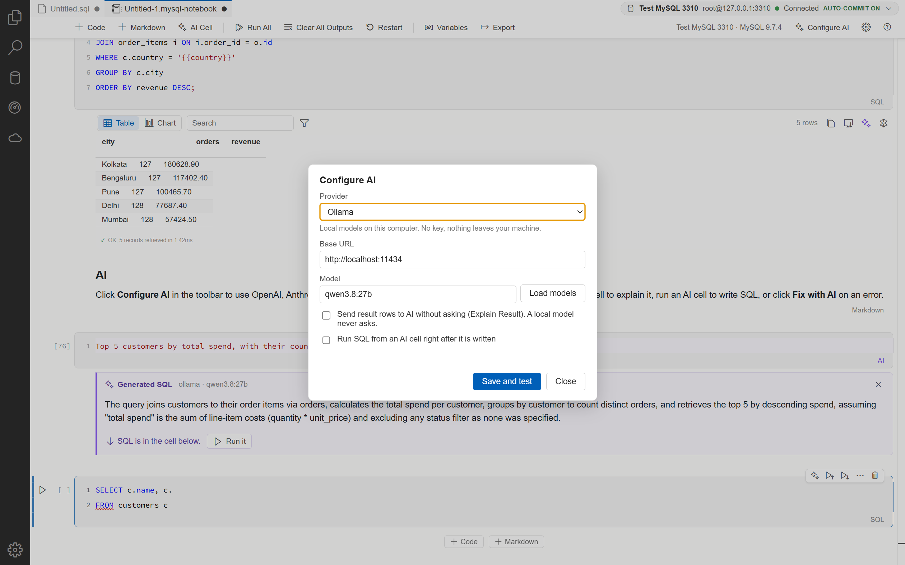
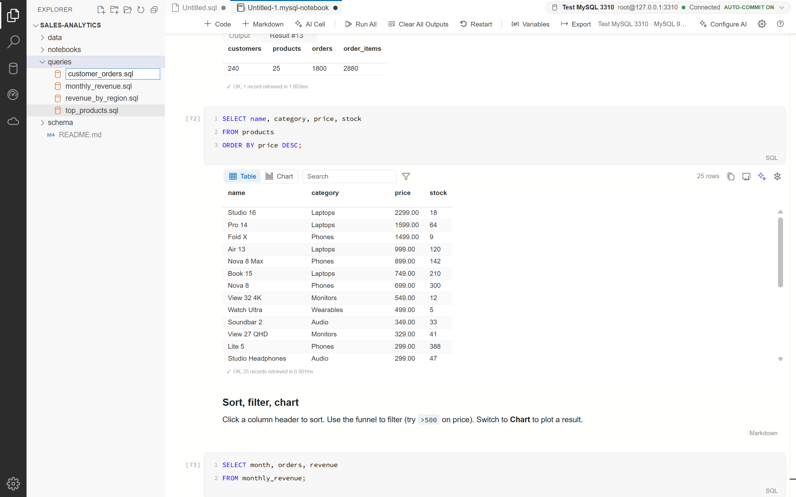
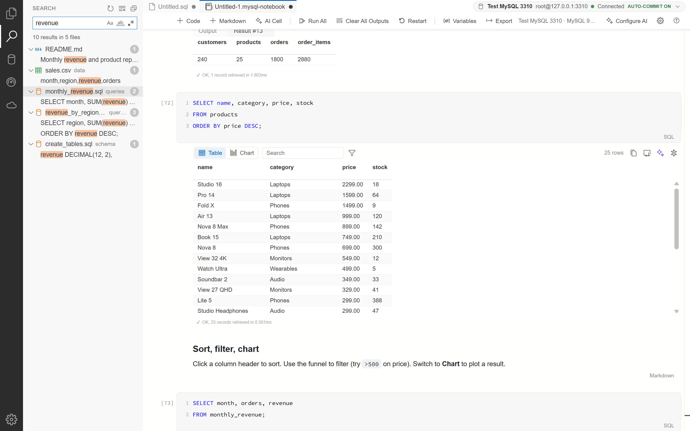

<div align="center">


# Modern MySQL Workbench

### A PLUGIN for MySQL Workbench, not a separate Workbench

**It needs MySQL Workbench 26 installed on your PC. It adds a Jupyter-style notebook, AI, result charts, exports and
a VS Code-style workspace to your own Workbench.**

A free plugin by KGP Talkie. It runs on top of your installed Workbench and does not change a single Workbench file.


[](LICENSE)


[Install](#install) · [Features](#features) · [How it works](#how-it-works) · [Development](#development) ·
[Changelog](CHANGELOG.md)



</div>

> [!IMPORTANT]
> **This is a plugin, not a full MySQL Workbench.** It does not install MySQL Workbench or a MySQL server. Install
> [MySQL Workbench 26](https://dev.mysql.com/downloads/workbench/) first (free, from Oracle). Modern MySQL Workbench
> then opens your own Workbench with the notebook, AI, charts and exports added.

## Contents

- [Features](#features)
- [Choosing an AI model](#choosing-an-ai-model)
- [Requirements](#requirements)
- [Versions](#versions)
- [Install](#install)
- [Update and uninstall](#update-and-uninstall)
- [How it works](#how-it-works)
- [Privacy and security](#privacy-and-security)
- [Troubleshooting](#troubleshooting)
- [FAQ](#faq)
- [Repository layout](#repository-layout)
- [Development](#development)
- [Contributing](#contributing)
- [License](#license)

## Features

### Notebook

- One box per cell, line numbers, `[n]` run counts, a play button on hover, Markdown cells that render when you
  leave them.
- Notebook bar: + Code, + Markdown, + AI Cell, Run All (waits for every statement), Clear All Outputs, Restart,
  Variables, Export.
- Command mode like Jupyter: Esc, then A/B add, D D delete, M/Y change type, C/X/V copy/cut/paste, Z undo. Every cell
  action is one undo step, and a deleted cell comes back with its output.
- The bar shows which server the notebook talks to, for example `Local · MySQL 9.4.0`, plus a Production or
  Read-only tag.



### Typing SQL

- MySQL keywords turn into capitals as you type. Names, strings, comments, `quoted` names and `{{variables}}` stay as
  typed, and one Ctrl+Z puts a word back. The keyword lists come from the
  [sql-formatter](https://github.com/sql-formatter-org/sql-formatter) MySQL dialect, not a hand-kept list.
- Autocomplete matches in any case and fuzzily (`slt` finds SELECT, `cstm` finds customers), lists the columns after
  an alias or table name (`c.`), and inserts keywords in UPPERCASE, lowercase or as typed.
- Shift+Alt+F turns a query into one clause per line and back.



### Results

- Search, per-column filters (`>500`, `1..5`, `null`, `!text`), sort, copy as CSV, TSV, JSON, Markdown or INSERT,
  save as CSV or JSON, a value viewer on double-click.
- Charts: bar, line, area, scatter and pie, stacked or horizontal, saved per cell.





### Running safely

- `{{name}}` variables (asked once per session or saved with the notebook) and `{{env.NAME}}`.
- Asks before DROP, TRUNCATE, or DELETE / UPDATE without WHERE. Connections can be tagged Production or Read-only.
- Query timeout.



### AI

- OpenAI, Anthropic, OpenRouter, Ollama, or any OpenAI-compatible API (LM Studio, vLLM, LiteLLM).
- Explain a cell, optimize it (with its EXPLAIN plan), Fix with AI on errors, explain a result, and AI cells that
  turn plain words into SQL in the cell below.
- Your API key stays on your PC, encrypted (see [Privacy and security](#privacy-and-security)).
- Pick a model that is big enough. See [Choosing an AI model](#choosing-an-ai-model).





### Files and schema

- Export the notebook as HTML (charts included), PDF, Markdown, `.sqlnb` or `.sql`. Import `.sql` or `.sqlnb`.
- Schema tree: Select Top 100 in Notebook and Describe in Notebook.
- A VS Code-style activity bar with an Explorer panel for a folder of `.sql` and notebook files, and a sample
  notebook (`sample_shop`) under Get Started.
- New File and New Folder in the Explorer bar, as in VS Code: type the name in the box that opens, press Enter.
  `reports/monthly.sql` makes the `reports` folder too. A new `.sql` file opens in Workbench straight away.
- Search (the magnifier in the activity bar, or Ctrl+Shift+F) finds text in every file of the open folder, and
  file names too. Results are grouped by file, with Match Case, Match Whole Word and Regular Expression. Click a
  line to open the file at that line. A file that is already open switches to its tab instead of opening twice.





## Choosing an AI model

**The plugin does not write the SQL. The model does.** The plugin sends your request and your table and column names
to the model you pick, and shows what comes back. If the answer is bad, the model is the reason, not the plugin.
A stronger model gives better answers.

### Local models (Ollama, LM Studio)

| Model size | For SQL in this plugin |
|---|---|
| 0.5b to 4b | **Not good enough.** Makes up tables and columns, joins the wrong columns, explains SQL it did not write. |
| 8b to 14b | The minimum. Fine for simple queries; mistakes on bigger joins. |
| 27b to 32b | **Recommended.** Good SQL and good explanations. The AI cell GIF above uses `qwen3.8:27b` on Ollama. |

- **If you use a small model (4b or less) and the SQL is wrong, the plugin is not broken. The model is too small.**
  Please do not report it as a bug. Use a bigger model, or a cloud model, and try again.
- Bigger models need more memory. As a rough guide, an 8b model needs about 6 to 8 GB of free GPU memory and a 27b
  to 32b model about 16 to 24 GB. A model that does not fit in GPU memory runs on the CPU and is very slow. If your
  PC cannot run a big enough model, use a cloud model instead.

### Cloud models

Cloud models are large and give good SQL on any PC.

- **Paid:** OpenAI, Anthropic or OpenRouter. Pick the provider in Configure AI and paste your API key.
- **Free:** several services give a free API key with daily or monthly limits. Some that work with this plugin:

  | Service | In Configure AI |
  |---|---|
  | **OpenRouter** (openrouter.ai) | Provider **OpenRouter**, a model whose name ends in `:free`, your OpenRouter key |
  | **Google Gemini** (aistudio.google.com) | **Custom (OpenAI-compatible)**, Base URL `https://generativelanguage.googleapis.com/v1beta/openai/`, your Gemini API key |
  | **Groq** (console.groq.com) | **Custom (OpenAI-compatible)**, Base URL `https://api.groq.com/openai/v1`, your Groq API key |
  | **NVIDIA NIM** (build.nvidia.com) | **Custom (OpenAI-compatible)**, Base URL `https://integrate.api.nvidia.com/v1`, your NVIDIA API key |

Free offers, their limits and their model names change often. When you install the plugin, search Google for
"free AI API" or "free LLM API" to see what is on offer at that time. Pick the biggest model the free plan allows.
Read each service's terms first: some free plans may keep your requests or use them for training, so do not send
private data to them.

## Requirements

| | |
|---|---|
| Operating system | Windows 10 or 11 (64-bit) |
| MySQL Workbench | 26 (the new Workbench that replaces Workbench 8 and MySQL Shell for VS Code). Tested with 26.10.0. |
| Rights | A normal user account. No admin rights are needed. |
| Optional | Microsoft Edge for PDF export (it ships with Windows). An AI provider account or a local Ollama for AI. |

## Versions

Version numbers follow MySQL Workbench. In **26.10.0.1** the first three numbers, **26.10.0**, are the MySQL
Workbench version this release is made and tested for, and the last number, **1**, is our release for it. A fix
for the same Workbench becomes 26.10.0.2. When MySQL Workbench 26.11.0 comes out, the release made for it is
26.11.0.1. Pick the release that matches your Workbench (Help > About in Workbench).

If Workbench updates itself before a matching release is out, the plugin keeps working as long as the parts of
Workbench it needs are unchanged. If they changed, it turns itself off and Workbench works as normal (see the
[FAQ](#faq)).

## Install

1. Download `Modern-MySQL-Workbench-Setup.exe` from the
   [Releases page](https://github.com/laxmimerit/mysql-workbench-plugin/releases) (or build it, see
   [Development](#development)).
2. Run it. It installs for your user only, in `%LOCALAPPDATA%\Programs\Modern MySQL Workbench`, and
   adds a **Modern MySQL Workbench** shortcut to the Desktop and the Start menu.
   The shortcut's icon is your own MySQL Workbench icon with a small notebook badge in the corner, made on your PC
   when you install, so you can tell the two shortcuts apart.
3. Open **Modern MySQL Workbench**.

Plain MySQL Workbench stays exactly as it was and still opens from its own shortcut. Workbench allows one window per
profile, so close plain Workbench before you open Modern MySQL Workbench.

## Update and uninstall

- **Update:** run the new `Modern-MySQL-Workbench-Setup.exe`. It replaces the installed copy and keeps your settings and AI
  configuration.
- **Uninstall:** Settings > Apps > Installed apps > Modern MySQL Workbench > Uninstall. This removes the program folder, the
  shortcuts and the Apps entry. MySQL Workbench is not touched. Your AI settings stay in
  `%APPDATA%\Modern MySQL Workbench`; delete that folder too if you want them gone.

## How it works

MySQL Workbench 26 is an Electron app whose launcher accepts a `--renderer-url` option. The Modern MySQL Workbench shortcut
starts a small local server on `127.0.0.1:9241` and opens Workbench with that option. The server hands Workbench its
own installed frontend, read-only, with one extra `<script>`: `plugin/kgptalkie-plugin.js`. Nothing in the Workbench
install folder is modified, and the server stops by itself a few minutes after the last Workbench window closes.

`docs/internals/NOTEBOOK-PLAN.md` explains the Workbench internals the plugin relies on, and
`docs/SQLNB-FEATURES.md` maps every feature to the SQL Notebook Studio feature it ports.

## Privacy and security

- The plugin server listens on `127.0.0.1` only. Its file, AI and PDF endpoints answer Workbench's own page only
  (origin and host checks plus a custom header, so other web pages are refused).
- The Explorer and Search read files. The only thing they write is a new empty file or folder when you use
  New File or New Folder; they never overwrite, rename or delete anything.
- Search skips `.git`, `node_modules`, binary files and files over 2 MB, and stops at 2,000 matches.
- AI API keys are stored with Windows DPAPI in `%APPDATA%\Modern MySQL Workbench\ai.json`, readable only by your Windows
  account. They are never sent to the page and never written into notebooks.
- AI requests go from the local server straight to the provider you choose. Result rows are sent only after you
  agree (or when you pick a local model or "Always allow").
- No telemetry.

Found a security problem? See [SECURITY.md](SECURITY.md).

## Troubleshooting

| Problem | What to do |
|---|---|
| "Port 9241 is in use by another program" | Another program holds the port. Close it, or open plain Workbench from its own shortcut. |
| "MySQL Workbench is already open without the plugin" | Close Workbench (File > Exit), then open Modern MySQL Workbench again. |
| "MySQL Workbench 26 was not found" | Install MySQL Workbench 26 first. The plugin looks in `%LOCALAPPDATA%\Programs` and `Program Files`. |
| PDF export fails | PDF export uses Microsoft Edge. Check that Edge is installed. |
| AI writes wrong SQL, makes up tables or columns | The model is too small. Use a local model of 27b to 32b (8b at the very least), or a cloud model. This is not a plugin bug. See [Choosing an AI model](#choosing-an-ai-model). |
| AI is very slow | A local model that does not fit in GPU memory runs on the CPU. Use a model that fits, or a cloud model. |
| A note says "Modern MySQL Workbench is turned off" | MySQL Workbench was updated and changed inside, so the plugin turned itself off to keep Workbench working. Install the latest Modern MySQL Workbench from the [Releases page](https://github.com/laxmimerit/mysql-workbench-plugin/releases). |
| Something else went wrong | The launcher writes details to `%TEMP%\modern-mysql-workbench.log`. Please attach it to a [bug report](https://github.com/laxmimerit/mysql-workbench-plugin/issues/new/choose). |

## FAQ

**Which AI model should I use?**
A cloud model, or a local model of 27b to 32b parameters (for example `qwen3.8:27b` on Ollama). 8b is the very
least. See [Choosing an AI model](#choosing-an-ai-model).

**The AI gave a wrong query or a bad explanation. Is the plugin broken?**
No. The plugin passes your request and your table and column names to the model and shows its answer. The quality of
that answer depends only on the model you chose in Configure AI. Small models (4b and below) often get SQL wrong.
Pick a stronger model and ask again.

**My PC has no strong GPU. Can I still use AI?**
Yes. Use a cloud model. OpenRouter, Google Gemini, Groq and NVIDIA NIM have free plans, and a Google search for
"free AI API" shows what else is on offer today. Paid providers (OpenAI, Anthropic, OpenRouter) work too.

**What data goes to the AI?**
Your request, the cell's SQL and the table and column names it needs. Result rows only when you agree, or when you
turn that on. With a local model (Ollama, LM Studio) nothing leaves your PC.

**Does the plugin change MySQL Workbench?**
No. No Workbench file is changed. Plain MySQL Workbench still opens from its own shortcut, exactly as before.

**What happens when MySQL Workbench updates itself?**
If the update changes the parts of Workbench the plugin builds on, the plugin turns itself off, takes out everything
it added and shows a short note. Workbench keeps working as normal. Install the latest Modern MySQL Workbench to get
the notebook features back.

## Repository layout

| Path | What it is |
|---|---|
| `plugin/kgptalkie-plugin.js` | The plugin: everything that runs inside Workbench |
| `package/kgptalkie_workbench.py` | One program that is the installer, the launcher and the local server |
| `package/build.ps1` | Builds `package/dist/Modern-MySQL-Workbench-Setup.exe` with PyInstaller |
| `launch.py` | Starts the server from this folder and opens Workbench with the plugin (development) |
| `tools/` | `gen-keywords.mjs` (MySQL keyword lists from sql-formatter), `cdp.py` and `snap.js` (drive a Workbench started with a debug port) |
| `tests/` | The hidden test environment and the tests (see [tests/README.md](tests/README.md)) |
| `docs/` | Feature map, notes on Workbench internals, screenshots |
| `.github/` | Issue and pull request templates, CI checks |

## Development

Requirements: Node.js 22 or later, Python 3.12 or later with `requests` and `websocket-client` (test tools), and
PyInstaller (installer build).

```bash
npm install
npm run keywords
py launch.py
```

`npm run keywords` rewrites the block between `KEYWORDS:BEGIN` and `KEYWORDS:END` in `plugin/kgptalkie-plugin.js`. Run it
after updating sql-formatter. `npm run check` checks the syntax of the plugin and the Python programs.

Build the installer:

```bash
powershell -File package/build.ps1
```

Every change is tested in a separate, hidden Workbench with its own profile and a throwaway MySQL server, never in
your everyday Workbench. See [tests/README.md](tests/README.md).

## Contributing

Bug reports and ideas are welcome. Please read [CONTRIBUTING.md](CONTRIBUTING.md) and the
[Code of Conduct](CODE_OF_CONDUCT.md) first.

## License

Apache License 2.0. See [LICENSE](LICENSE) and [NOTICE](NOTICE). If you redistribute this plugin or a work based on
it, keep the NOTICE file with it. Third-party licenses are in [THIRD-PARTY-NOTICES.txt](THIRD-PARTY-NOTICES.txt).

### Trademarks

The license covers the code, not the names. "KGP Talkie" and its logo are not licensed for use by forks; if you
publish a fork, give it your own name. MySQL and MySQL Workbench are trademarks of Oracle and/or its affiliates. This
plugin is not made, endorsed or supported by Oracle.

About the logo: the dolphin icon at the top of this page is the MySQL Workbench icon, a trademark of Oracle. It is
shown only to make clear which program this plugin works with. The part that belongs to this project is the small
badge in the corner (the database and the notebook card). The installer does not ship Oracle's icon: it makes the
shortcut icon on your PC from the MySQL Workbench you already have installed, and adds the badge. If Oracle asks,
the logo will be changed.
